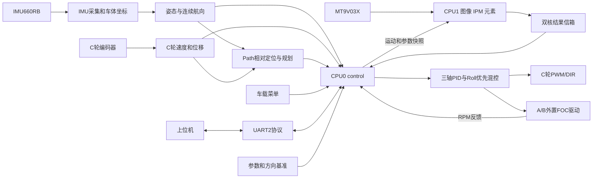

# 文件结构与程序架构

更新：2026-09-21。本说明对应本次分类后的源码，覆盖全部自编写固件文件、双核入口和上位机主要文件；厂商库按已有组件分类说明。目录整理不改变控制算法、75 项参数、Flash 格式、IO 接线或中断归属。

## 1. 分类依据与目录总览

参考所提供 CYT4bb7_Car 工程的 `project/code/Common`、`Controller`、`Estimation`、`HW_Drivers`、`Menu`、`Protocols` 分层方式。该工程的 IAR/CYT4 启动文件不适用于 TC264，因此保留本项目 ADS 根目录、`user/` 双核入口和 `libraries/`，不额外套一层 `project/`。

```text
ASC_SummerTraining_Unicycle/
├─ README.md                         项目入口、操作文档索引
├─ .project / .cproject / .settings/  ADS 工程、编译及索引设置
├─ Lcf_Tasking_Tricore_Tc.lsl         TC264 链接、栈和内存分配
├─ user/                             双核入口与中断
├─ code/                             应用源码；统一头文件搜索根目录
│  ├─ Common/                       板级配置、方向基准、参数与 PID
│  ├─ Controller/                   控制总调度、三轴闭环、模式与保护
│  │  └─ Planner/                   路径采集、跟踪规划和路线保存
│  ├─ Estimation/
│  │  ├─ Attitude/                  姿态解算
│  │  └─ Vision/                    图像、逆透视、赛道元素与双核信箱
│  ├─ HW_Drivers/
│  │  ├─ IMU/                       IMU 采集、坐标转换与标定
│  │  └─ Motor/                     A/B 无刷串口驱动、C 轮驱动与编码器
│  ├─ Menu/                         车载菜单、图像页和路线图
│  └─ Protocols/                    UART2 参数、遥测、路径传输协议
├─ libraries/                        Infineon 与逐飞基础库
├─ docs/
│  ├─ 文件结构与程序架构.md           本文
│  ├─ guides/                       操作、参数与调试指南
│  └─ design/                       方向、IMU 与压弯设计说明
├─ tools/
│  ├─ ads/                          ADS 自动构建工具
│  ├─ tests/                        路径导航固件主机测试
│  └─ unicycle_station/             Windows 上位机完整工程
├─ .agents/skills/                   项目开发 skill 与参考资料
├─ Debug/、Release/、.ads/            构建输出/缓存，不是源码
└─ chip_backup/、.tmp_memtool_help/  本机备份/临时资料，保留原位置
```

目录是职责分类，不等于严格的单向依赖边界。例如控制需要视觉结果，菜单和协议调用控制入口；部分模块仍通过公共状态连接。本次没有拆分函数或改变这些依赖。

## 2. 自编写固件文件逐项说明

下表路径均相对项目根目录；同名 `.c` 为实现，`.h` 为对外声明/数据契约。三个 `.inc` 是所属 `.c` 的代码片段，不独立编译。

### 双核入口：user

| 文件 | 作用 |
|---|---|
| [user/cpu0_main.c](../user/cpu0_main.c) | 主控核入口：时钟与屏幕初始化，调用控制/菜单初始化，同步双核；前台处理命令、菜单、IPM 保存和遥测格式化。 |
| [user/cpu0_main.h](../user/cpu0_main.h) | 逐飞时钟库使用的 `AppInfo`、`App_Cpu0` 和 `g_AppCpu0` 声明；不是另一个主循环。 |
| [user/cpu1_main.c](../user/cpu1_main.c) | 视觉核入口：同步后初始化摄像头视觉服务，持续运行 `vision_core_run()`。 |
| [user/isr.c](../user/isr.c) | 控制定时器、UART、摄像头 VSYNC/DMA 等中断函数；将硬件事件交给相应模块。 |
| [user/isr.h](../user/isr.h) | 中断文件公共包含入口；向量由 `IFX_INTERRUPT` 定义。 |
| [user/isr_config.h](../user/isr_config.h) | 逐飞库要求的无参数转接头；中断核与优先级统一在 config.h。 |

### 公共配置与算法：code/Common

| 文件 | 作用 |
|---|---|
| [code/config.h](../code/config.h) | 引脚、中断路由、方向基准、周期、PID/保护默认值及 WiFi 公共配置的唯一入口。 |
| `code/config_private.h`（本机、不跟踪） | 热点名、密码和电脑目标 IP；模板为 config_private.example.h。 |
| [code/Common/param.h](../code/Common/param.h) | `param_t`、参数描述结构、Flash 格式版本和运行宏；区分界面数值与实际控制符号。 |
| [code/Common/param.c](../code/Common/param.c) | 75 项参数表、查找/修改/限幅、默认值、旧格式迁移、分组保存、CRC/回读与机械零点联动。 |
| [code/Common/pid.h](../code/Common/pid.h) | PID 状态结构和位置式/增量式接口。 |
| [code/Common/pid.c](../code/Common/pid.c) | PID 计算、积分状态与条件抗饱和、限幅和复位；没有显式 dt 因子。 |

### 控制与路径：code/Controller

| 文件 | 作用 |
|---|---|
| [code/Controller/control.h](../code/Controller/control.h) | 模式、控制状态、测试/点动、视觉结果接收、路径控制和公共停车接口。 |
| [code/Controller/control.c](../code/Controller/control.c) | CPU0 控制总调度：初始化与安全门槛，三轴串级，Run/Remote/Path/测试互斥，速度规划、压弯、Roll 优先混控和故障退出。 |
| [code/Controller/control_angle.inc](../code/Controller/control_angle.inc) | 三个角度 PID 的周期适配，只由 control.c 包含；保留菜单/Flash 的 5 ms 参数基准。 |
| [code/Controller/Planner/path_nav.h](../code/Controller/Planner/path_nav.h) | 路径点、状态/错误枚举、导航约束以及采集/导入/运行/查询接口。 |
| [code/Controller/Planner/path_nav.c](../code/Controller/Planner/path_nav.c) | 编码器位移+相对航向积分、路线采点、几何验证、前瞻跟踪、速度包络及终点/离轨/停滞状态机。纯导航，不直接驱动电机。 |
| [code/Controller/Planner/path_store.h](../code/Controller/Planner/path_store.h) | 路线存储初始化、保存和加载接口。 |
| [code/Controller/Planner/path_store.c](../code/Controller/Planner/path_store.c) | 路线编码、CRC、代数选择、DFlash 9/10 双槽保存、写后回读与损坏回退；主机测试用专用 Flash 桩。 |

### 状态估计：code/Estimation

| 文件 | 作用 |
|---|---|
| [code/Estimation/Attitude/attitude.h](../code/Estimation/Attitude/attitude.h) | Roll/Pitch/Yaw 姿态状态、更新和收敛/异常查询接口。 |
| [code/Estimation/Attitude/attitude.c](../code/Estimation/Attitude/attitude.c) | A+ r10h 适配层：1 ms 核心更新、1 ms 欧拉角发布、重力对齐、时序/异常与收敛查询。 |
| [code/Estimation/Vision/image.h](../code/Estimation/Vision/image.h) | 图像尺寸、边线/中线/点来源数据及处理接口。 |
| [code/Estimation/Vision/image.c](../code/Estimation/Vision/image.c) | 188×120 整帧图像处理：阈值、逐行边线追踪、半宽学习、最终中线与道路几何/质量输出。 |
| [code/Estimation/Vision/perspective.h](../code/Estimation/Vision/perspective.h) | IPM 矩阵、点变换、可用性和标定接口。 |
| [code/Estimation/Vision/perspective.c](../code/Estimation/Vision/perspective.c) | 逆透视点集变换、矩阵求解/验证、多帧标定；不是全帧重采样的显示特效。 |
| [code/Estimation/Vision/element.h](../code/Estimation/Vision/element.h) | 元素类型、状态、跟踪模式及元素处理接口。 |
| [code/Estimation/Vision/element.c](../code/Estimation/Vision/element.c) | 斑马线、十字、左右环岛和坡道识别/状态转换、补线与限速/停车请求。 |
| [code/Estimation/Vision/vision_core.h](../code/Estimation/Vision/vision_core.h) | 双核共享结果、参数反馈、命令和显示快照契约。 |
| [code/Estimation/Vision/vision_core.c](../code/Estimation/Vision/vision_core.c) | CPU1 摄像头生命周期与整帧流水线，CPU0/1 双向信箱、序号锁、内存屏障和显示快照所有权。它包含双核接口，并非全部函数只由 CPU1 调用。 |

### 硬件适配：code/HW_Drivers

| 文件 | 作用 |
|---|---|
| [code/HW_Drivers/IMU/imu.h](../code/HW_Drivers/IMU/imu.h) | 车体系加速度/角速度、标定状态、连续航向、链路与前向待重启接口。 |
| [code/HW_Drivers/IMU/imu.c](../code/HW_Drivers/IMU/imu.c) | IMU660RB 初始化/寄存器配置、陀螺与加速度采样、传感器到车体换轴、静止零偏标定及角速度累计。 |
| [code/HW_Drivers/Motor/W_Motor.h](../code/HW_Drivers/Motor/W_Motor.h) | A/B 双路指令、停机/释放、RPM 与驱动状态接口。 |
| [code/HW_Drivers/Motor/W_Motor.c](../code/HW_Drivers/Motor/W_Motor.c) | UART3 外置双无刷驱动通信、双路输出与 RPM 同源极性、软件刹车、转速请求和通信看门狗。磁编码器与 FOC 在外置板运行。 |
| [code/HW_Drivers/Motor/Y_Motor.h](../code/HW_Drivers/Motor/Y_Motor.h) | C 轮输出、编码器采样、速度/位移查询接口。 |
| [code/HW_Drivers/Motor/Y_Motor.c](../code/HW_Drivers/Motor/Y_Motor.c) | C 轮 DRV8701E 的 PWM/DIR、输出限幅/死区、TIM2 脉冲/方向计数、20 ms 速度窗口和米制换算。 |

### 车载交互：code/Menu

| 文件 | 作用 |
|---|---|
| [code/Menu/menu.h](../code/Menu/menu.h) | 菜单初始化与前台运行入口。 |
| [code/Menu/menu.c](../code/Menu/menu.c) | 页面状态、按键、参数编辑/保存、Test/Jog/Run 操作和状态显示，包含 `menu_path.inc`。 |
| [code/Menu/menu_path.inc](../code/Menu/menu_path.inc) | Path 页面与路线图、手推/遥控采集、运行/保存/加载操作；共享 `menu.c` 的私有状态。 |
| [code/Menu/display.h](../code/Menu/display.h) | 图像页模式、曝光设置与图像页面入口。 |
| [code/Menu/display.c](../code/Menu/display.c) | CPU0 图像页面绘制，向 CPU1 请求并释放灰度/二值/叠线快照；不自行在 CPU0 跑视觉算法。 |

### 通信：code/Protocols

| 文件 | 作用 |
|---|---|
| [code/Protocols/vofa.h](../code/Protocols/vofa.h) | UART2 初始化、1 ms 有界收发、前台解析/格式化、遥测和协议状态接口。 |
| [code/Protocols/vofa.c](../code/Protocols/vofa.c) | cfg 参数/状态/Schema、完整行 speed/stop、权限检查、请求响应、RX/TX 环与遥测；包含下面两个片段。 |
| [code/Protocols/vofa_task.inc](../code/Protocols/vofa_task.inc) | 视觉任务状态采样与转换事件发布，对应 `task`/`taskevt`。 |
| [code/Protocols/vofa_path.inc](../code/Protocols/vofa_path.inc) | 路线上传/下载、CRC、修订号、启动车令牌和延后保存/加载，对应 `cfg:path_*` 与路径遥测。 |

## 3. 整体数据流



视觉 Run 与 Path 导航提供不同的速度/转向目标，最终共用 CPU0 的姿态平衡、压弯、混控和保护。Path 使用轮式里程与 IMU 相对航向，**不是通过加速度二次积分获得绝对位置**，也不依赖视觉中线。轮胎打滑、编码器标定误差和航向漂移仍会影响路线复现。

控制分工：Roll 用 A/B 差动，Pitch 用 C 行进轮，Yaw 用 A/B 共模。A/B 输出优先分配给 Roll，剩余余量给 Yaw。目录调整不改变方向适配与增益含义。

A+ 核心目录 `code/Estimation/Attitude/r10h/` 包含六个 C 编译入口；`imu_r10h.inc` 与 `imu_spi.inc` 由 IMU 驱动包含。接入说明见 [A+ r10h 移植说明](design/Aplus-r10h移植说明.md)。

## 4. 启动、周期与双核边界

CPU0 从 `core0_main()` 初始化时钟/屏幕，再由 `control_init()` 加载参数和路线、初始化驱动与 PID、执行 6000 点 IMU 静止标定（约 6 秒），最后启动控制定时器。CPU1 与 CPU0 同步后初始化摄像头并持续处理帧。

| 执行位置/周期 | 主要工作 |
|---|---|
| CPU0 前台 | `vofa_cmd_poll → menu_run → control_ipm_flush → vofa_poll`；命令、UI、Schema、Flash、遥测格式化。 |
| CPU0 1 ms | 控制中断、六轴采样/A+ 核心解算/角速度环、保护/模式与混控，驱动链路服务，有界 UART 搬运。 |
| CPU0 1 ms 同拍 | 姿态角发布、三个角度外环；正常 Roll 更新时重算 Pitch 投影缓存。 |
| CPU0 5 ms | 编码器采样、运动反馈、Path 位移积分及压弯更新。 |
| CPU0 10 ms | 按键扫描。 |
| CPU0 20 ms | 速度/回收/方向控制；Path 每四次 5 ms 调用执行一次规划。 |
| CPU1 每帧 | 摄像头帧获取、边线、标定/元素、最终中线与几何、结果及显示快照发布。 |

Flash 擦写、全路线启动预计算、格式化和屏幕绘图不在 1 ms 控制中断中进行。UART2 参数与遥测归 CPU0，UART3 A/B 驱动归 CPU0；摄像头 UART1、VSYNC 与 DMA5 服务归 CPU1。`IFX_INTERRUPT` 的向量表号与服务核是两个不同设置，不能因移动文件而改动。

内存由链接脚本和源码段声明决定：`cpu0_dsram` 存 CPU0 状态，`cpu1_dsram` 存 CPU1 视觉状态，`vision_shared` 存共享信箱，部分视觉热代码放入 `cpu1_psram`。跨核依赖序号锁、`__dsync()` 和 request/read/release 协议；目录名本身不决定代码在哪个核运行。

## 5. 模式、参数与持久化

- `control.c` 是所有动作的控制入口；菜单和协议应调用其接口，避免自行绕过互斥/姿态/驱动保护去输出电机。
- STOP、Jog、单轴 Test、Balance、Remote、Odometry、视觉 Run 和 Path 通过基础状态与附加标志区分，不能只看 `start_flag`。
- 普通 Run/Path 正常结束可能保留平衡，公共 `control_stop()` 才完全停止电机。
- 编译默认值在 `config.h`；运行值在 `param.c` 的 `g_param`。有效 Flash 覆盖默认值，Schema 是连接时实际值的依据。
- 方向基准在 `config.h`；IMU 前向切换需联动零点并保存重启。文件搬移没有修改这一语义。
- DFlash 第 11 逻辑页保存参数/IPM；第 9、10 页保存路线的双槽副本，两套保存/校验独立。路线不增加到 75 项参数表里。
- 当前 hello 标识为 `tc264-cfg1-task1-path1-sign2`。普通 cfg 不提供通用发车操作；Path 已有带修订号与一次性令牌的 `path_arm`/`path_start`，不能再将整个协议描述成“不支持任何远程启动”。

参数链路：`config.h → param_t/参数表 → 菜单/Schema → Flash → 上位机 Profile`。新增参数需一起核对这些入口。上位机路线链路：路线编辑 → 分段上传/CRC/提交 → 下载核对 → arm/start → Path 规划 → 公共平衡控制。

## 6. 上位机文件说明

`tools/unicycle_station/` 已按职责分类，本次保留其结构。它是独立 Python/PySide6 程序，不能加入 TC264 源文件编译。

| 相对 tools/unicycle_station/ 的路径 | 作用 |
|---|---|
| `run_station.py`、`app/main.py` | Python 启动入口与 Qt 应用启动。 |
| `start_app.bat`、`start_windows.bat` | 本机启动包装脚本。 |
| `build_windows.bat`、`scripts/build_windows.py`、`EmbeddedStation.spec` | Windows 桌面包构建入口、构建流程和 PyInstaller 描述。 |
| `pyproject.toml`、`requirements-lock.txt` | 项目/测试配置与依赖版本。 |
| `app/__init__.py` | Python 应用包标记。 |
| `app/core/models.py` | 设备 Profile、参数和工作区等基础数据模型。 |
| `app/core/store.py` | 通道数据缓存、时间轴与受限表达式派生通道。 |
| `app/core/live_parameters.py` | 可在线调整的速度/方向/压弯参数集合。 |
| `app/protocols/firewater.py` | 文本帧解析、时间跟踪和协议数据转换。 |
| `app/plugins/registry.py` | 协议插件注册与选择。 |
| `app/transports/serial_transport.py` | 实际串口通信。 |
| `app/transports/mock.py`、`mock_path.py` | 调试用模拟设备与路径协议模拟；不代表真实车辆性能。 |
| `app/services/engine.py` | 连接、数据流、参数、记录与业务服务总协调。 |
| `app/services/requests.py` | 带序号的请求排队、响应匹配和超时处理。 |
| `app/services/remote.py` | 遥控会话和速度/转向请求管理。 |
| `app/services/routes.py` | 米制路线文档、几何/传输验证、逐点确认与路线执行交互。 |
| `app/services/task_state.py` | 任务状态与轨迹等诊断数据整理。 |
| `app/services/experiments.py` | 试验记录、标记与对照流程。 |
| `app/services/background.py` | 后台磁盘任务、进度与协作取消，避免阻塞界面。 |
| `app/recording/session.py` | 会话记录、读取与回放相关数据处理。 |
| `app/plotting/scope.py`、`measurement.py` | 波形显示和区间测量。 |
| `app/visualization/orientation.py` | 三维姿态显示与显示坐标映射，不改变 MCU 传感器坐标。 |
| `app/ui/window.py` | 主窗口和页面/服务装配。 |
| `app/ui/connection.py` | 连接配置及串口状态界面。 |
| `app/ui/overview.py` | 设备概览与关键状态。 |
| `app/ui/parameters.py`、`parameter_table.py` | 参数分组、编辑、权限、下发和保存界面/表格。 |
| `app/ui/edit_history.py` | 参数编辑历史。 |
| `app/ui/workbench.py` | 调试工作台和通道组合显示。 |
| `app/ui/task_page.py` | 视觉任务与诊断页面。 |
| `app/ui/route_page.py` | 路线编辑、地图、车端路线及执行页面。 |
| `app/ui/remote_page.py` | 遥控页面。 |
| `app/ui/experiments_page.py` | 试验管理页面。 |
| `app/ui/navigation.py` | 侧栏页面选择及动画；不是车辆路径导航算法。 |
| `app/ui/reorder.py` | 界面项目排序交互。 |
| `app/ui/interactions.py` | 窗口级 UI 缩放与交互。 |
| `app/profiles/tc264_unicycle/profile.json`、`display.json` | 本车协议/参数元数据、默认显示及仪表设置。 |
| `app/profiles/generic_sensor/profile.json` | 通用传感器示例配置。 |
| `scripts/generate_profiles.py` | 从固件参数表/默认值/菜单生成 Profile 与示例工作区；已更新至分类后的源码路径。 |
| `scripts/generate_example_log.py` | 生成示例数据日志。 |
| `scripts/*_smoke.py`、`scripts/endurance.py` | 界面交互、个性化、在线调试与持续运行检查工具。 |
| `tests/`、`tests/firmware_host/` | Python 回归测试、实际固件 C 提取测试及硬件接口桩。 |
| `examples/` | 示例工作区、参数预设和数据。 |
| `docs/` | 协议、通道、用户操作、诊断报告和历次快照；有日期的历史报告仍保留原结论和适用版本。 |
| `sessions/`、`artifacts/` | 本地记录与检查产物；实际用户会话目录以运行配置为准。 |
| `.venv/`、`build/`、`dist/`、`.pytest_cache/` | Python 环境、打包产物及缓存，不是固件源码。 |

## 7. 厂商库、工程与辅助工具

| 路径 | 作用与维护边界 |
|---|---|
| `libraries/infineon_libraries/` | Infineon iLLD、芯片寄存器/基础服务/启动支持；保持原结构。 |
| `libraries/zf_common/` | 逐飞通用工具、时钟、调试等。 |
| `libraries/zf_driver/` | GPIO、UART、SPI、PWM、编码器、Flash、DMA 等底层驱动。 |
| `libraries/zf_device/` | IMU、摄像头、屏幕、无线模块等器件驱动。已有 CPU1 摄像头/DMA 适配不应误当成未修改的原厂库。 |
| `libraries/zf_components/` | 按键等逐飞组件。 |
| `libraries/doc/` | 库和硬件使用资料。 |
| `.project` | ADS/Eclipse 工程身份、构建器和资源过滤。 |
| `.cproject` | TASKING 编译/链接设置、包含目录、源码排除项；保留 `code/` 包含根目录。 |
| `.settings/` | 项目级字符编码、器件与自动发现配置。 |
| `Lcf_Tasking_Tricore_Tc.lsl` | Flash/RAM/共享段、双核栈和链接布局；保留在根目录。 |
| `*.launch` | 本机调试启动配置，不是源码，也不是最新固件证明。 |
| `tools/ads/build.py` | 快照源码、启动真实 ADS 工作台构建、检查结果和生成哈希清单。递归收集 `code/`，支持新子目录。 |
| `tools/ads/BuildStartup.java` | ADS 工作台桥接插件，导入工程、发起构建并导出错误/日志。 |
| `tools/ads/test_build.py` | 构建工具自身的故意失败/恢复集成测试，不是普通固件单元测试。 |
| `tools/tests/test_path_nav.py` | 编译真实路径 C 代码并运行主机测试的入口。 |
| `tools/tests/path_nav_test.c` | 采集、规划、状态机、几何闭环模型和持久化测试。 |
| `tools/tests/path_store_stubs.h` | 路径存储主机测试的 Flash/停车接口桩，仅测试配置使用。 |
| `.agents/skills/develop-tc264-unicycle/` | 项目开发规范、源文件职责、构建与诊断参考；已同步新目录。 |
| `删除临时文件.bat` | 既有清理脚本，会删除 Debug、.ads 及 launch；本次未执行或修改，使用前应了解会丢失本地构建记录。 |
| `Debug/`、`Release/` | ADS 自动生成构建目录；不要手动搬移生成的 makefile 或将历史 HEX 视为新构建。 |
| `.ads/` | 本地构建摘要、固件副本及工作记录；不是版本化源码。 |
| `chip_backup/` | 现有芯片 PFlash/DFlash 读取备份，保留二进制原件与 README。 |
| `.tmp_memtool_help/`、`debug.log` | 本机临时工具资料/日志，保留现状并与应用源码分开。 |
| `.gitignore`、`.git/`、`.vscode/` | 版本忽略规则、版本数据库和本机编辑器设置；不参与固件功能。 |

## 8. 文档与修改入口

| 要做的事 | 优先阅读/修改 |
|---|---|
| 查看全部参数、默认值 | [参数参考](guides/参数参考.md)，`config.h` 与 `Common/param.c` |
| 调三轴 PID、模式、保护 | [控制调试指南](guides/控制调试指南.md)，`Controller/control.c` 与 `Common/pid.c` |
| 修改方向或 IMU 前向 | [方向基准整理](design/方向基准整理.md)、[IMU 前向切换](design/IMU前向切换说明.md)，`config.h`、`HW_Drivers/IMU/imu.c` |
| 改压弯 | [压弯控制说明](design/压弯控制说明.md)，`Controller/control.c` |
| 改视觉与赛道元素 | [视觉调试指南](guides/视觉调试指南.md)，`Estimation/Vision/` |
| 改路线采集/规划/保存 | [路径导航指南](guides/路径导航指南.md)，`Controller/Planner/` |
| 改车载页面 | [菜单指南](guides/菜单指南.md)，`Menu/` |
| 改上位机或协议 | [调参命令](guides/调参命令.md)、[PC 协议](../tools/unicycle_station/docs/protocol.md)、[PC 路线](../tools/unicycle_station/docs/path-navigation.md)，`Protocols/` 与上位机对应服务 |

原根目录的六份操作/调试文档已迁入 `docs/guides/`，三份设计文档迁入 `docs/design/`。README、相关文档链接、生成脚本、测试和 skill 已跟随更新。工作区原已删除的旧《转弯饱和与压弯评估》未恢复。

## 9. 编译、验证与后续新增文件

仍从根目录打开原 ADS 工程。已打开的 ADS 可刷新工程后执行 Clean/Build。项目规定的自动构建入口保持不变：

```powershell
python tools/ads/build.py --clean
python tools/tests/test_path_nav.py
tools/unicycle_station/.venv/Scripts/python.exe -m pytest tools/unicycle_station/tests -q
```

新增应用文件放入相应职责目录，包含路径使用相对 `code/` 的模块路径，例如 `#include "Common/param.h"`、`#include "Controller/control.h"`。不复制一份旧文件留在 `code/` 根目录，也不手工维护 Debug 下自动生成的规则。新增 `.inc` 应明确所属 `.c`。

`tools/`、`docs/`、`.agents/`、备份和临时目录不参与固件源码发现。构建产物的实际路径和哈希以 `.ads/build/latest.json` 为准。本次整理只调整布局、引用和工程发现规则；硬件时序、算法效果与实车表现没有在本次重新测量。

### 本次整理验证记录

- 37 个应用源码/头文件/包含片段已分类，6 个双核入口/中断文件保留在 user；本文逐项覆盖全部 43 个文件。
- 9 份原根目录文档已分类；文档和 skill 链接、源码生成脚本、固件主机测试路径已更新。
- 应用与启动文件逐一比对，除 `#include` 路径外内容不变；厂商库没有改动，原有文档删除未撤销。
- ADS/TASKING Clean 完整构建通过，0 错误、0 警告；路径导航主机测试全部通过；上位机与固件接口回归共 130 项通过。
- 没有烧录或实车试验。构建验证证明新目录能正确编译链接，不代表新增车辆性能结论。

构建输入 SHA-256：`570de142a503441199bb8071e8bafbeae4ab044a0f3983304c1fc56bfdc0e649`；本地结果清单 `.ads/build/latest.json`。

## WiFi-SPI 上位机接入（2026-09-22）

`code/Protocols/station_wifi.c/.h` 提供 CPU0 前台的分步 SPI 收发，`config.h` 选择 UART2/WiFi，`config_private.example.h` 是本机网络配置模板。`vofa.c` 复用原命令解析和参数权限，WiFi 构建不在 1 ms 中断执行 SPI。上位机 `app/transports/wifi_transport.py` 提供固定对端 UDP 通道。详见 [接线与使用说明](../tools/unicycle_station/docs/wifi-spi.md)。
